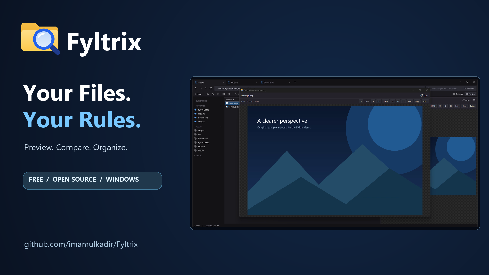
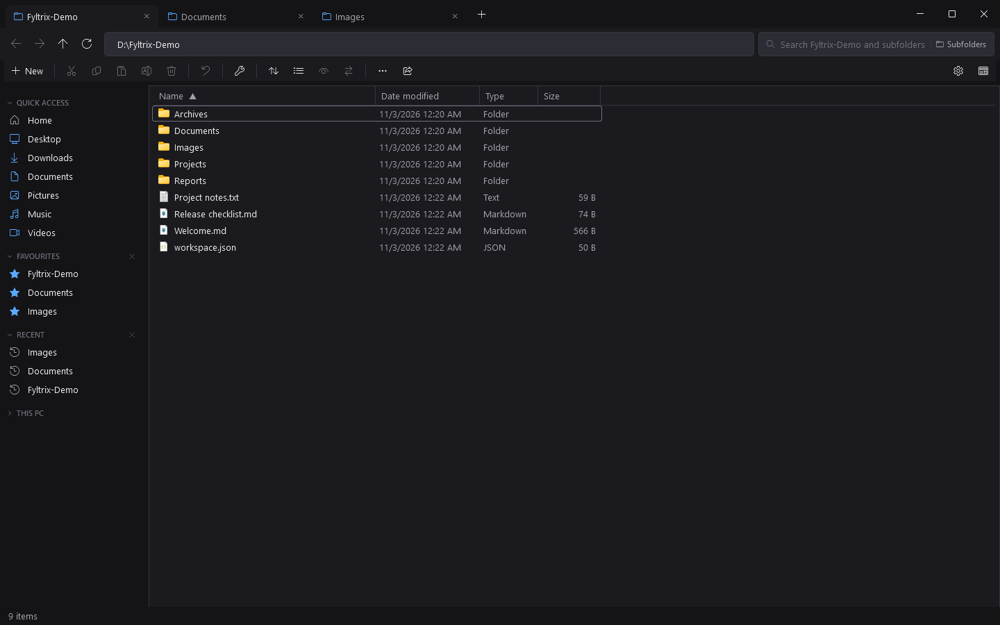
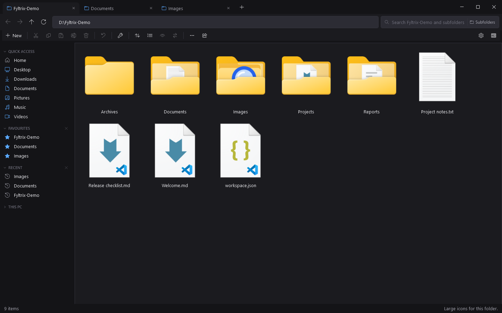
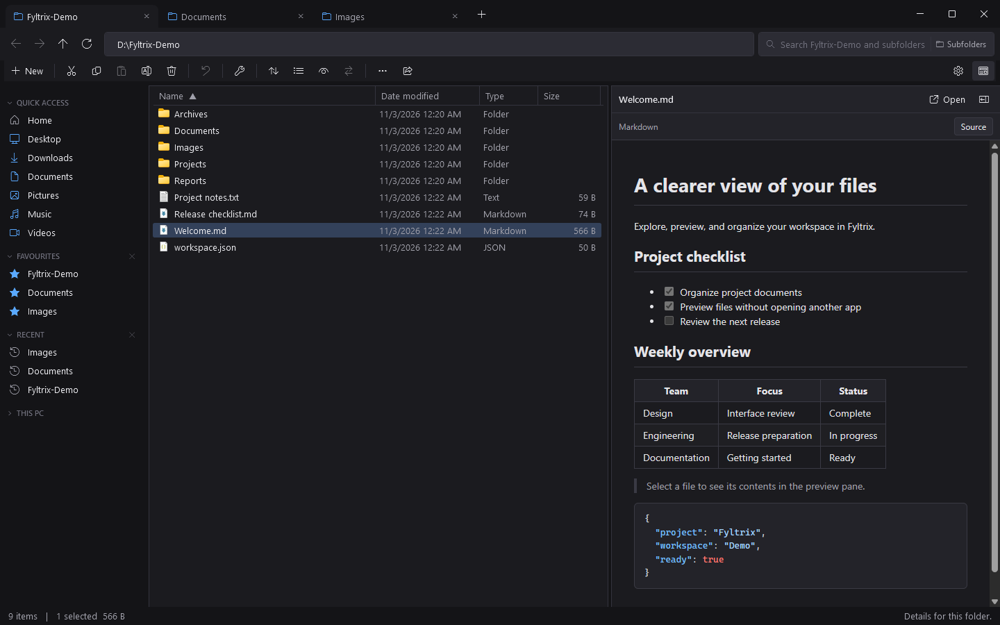
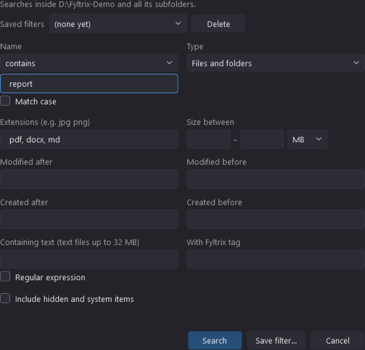
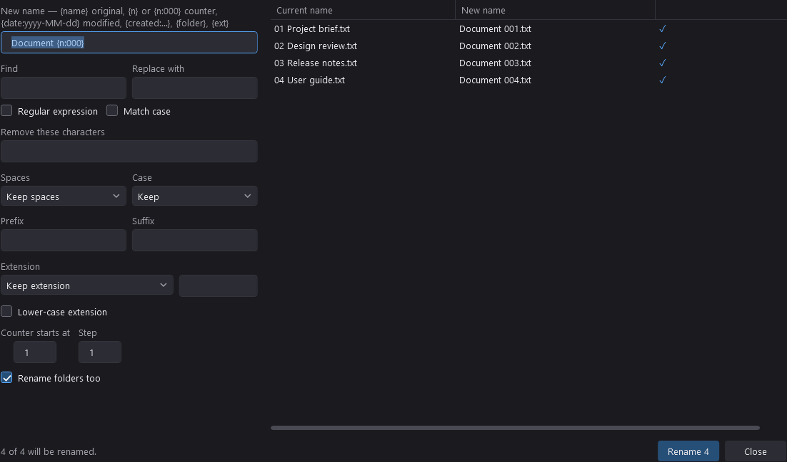
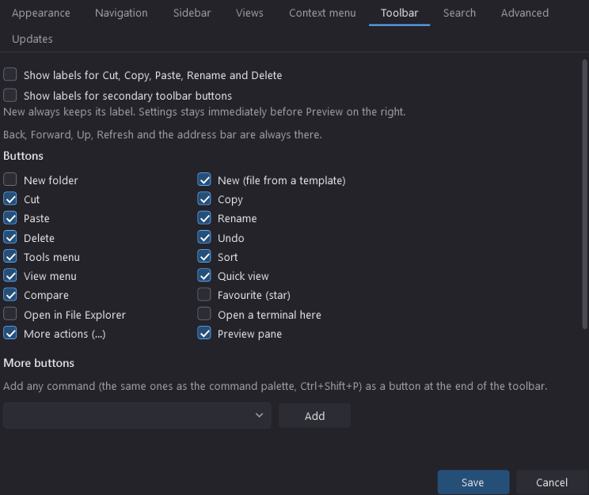

# Fyltrix — Your Files. Your Rules.

<div align="center">


# Fyltrix

**Your Files. Your Rules.**

_A modern, powerful, and highly customizable Windows file manager that goes beyond traditional File Explorer._

[](https://github.com/imamulkadir/Fyltrix/releases/latest)
[](https://github.com/imamulkadir/Fyltrix/releases)
[](https://github.com/imamulkadir/Fyltrix/stargazers)

[](LICENSE)
[](https://github.com/imamulkadir/Fyltrix/issues)
[](https://github.com/imamulkadir/Fyltrix)
[](https://dotnet.microsoft.com/)

**[Download Latest Release](https://github.com/imamulkadir/Fyltrix/releases/latest)** · **[Features](#features)** · **[Build from Source](#build-from-source)** · **[Report a Bug](https://github.com/imamulkadir/Fyltrix/issues)**

</div>

---

## Meet Fyltrix


<media

Windows File Explorer gets the job done. **Fyltrix is built for everything beyond that.**

Fyltrix is an open-source Windows file manager designed for people who want more control over their files, folders, drives, and workflows.

It brings together multi-tab navigation, rich file previews, advanced searching, file comparison, batch operations, integrated development tools, automation, and extensive personalization in a single desktop application.

Built with **C#, WPF, and .NET 8**, Fyltrix aims to provide a fast, responsive, native Windows experience without unnecessary complexity.

Whether you're a developer, power user, content creator, or simply someone who wants a better file manager, Fyltrix gives you the tools to work your way.

### Why Fyltrix?

- **More than browsing** — Preview, compare, edit, convert, organize, and share files.
- **Built around you** — Customize navigation, toolbar actions, context menus, folder views, and workspace preferences.
- **Developer-friendly** — IDE integration, syntax highlighting, advanced search, command palette, and scripting support.
- **Powerful file operations** — Batch rename, duplicate detection, folder comparison, archive management, and undo support.
- **Native Windows experience** — Modern tabs, familiar interactions, multi-monitor support, and keyboard shortcuts.
- **Privacy-conscious** — Local-first file management, with optional network sharing and automation.

---

## Screenshots

Explore the actual Fyltrix interface in dark mode. These captures use a separate demo workspace and disposable settings; the files and rename previews shown are examples.

### Main Interface

Tabbed navigation, the compact toolbar, Favourites, and a detailed file list.



### Customizable File Views

Switch from Details to large icons, with folder and file thumbnails.



### Rich File Previews

Read Markdown with headings, checklists, tables, and highlighted code beside the file list.



### Advanced Search

Combine name, extension, size, date, text-content, and tag filters.



### File Management Tools

Batch rename shows each proposed filename before applying changes.



### Personalization and Settings

Customize toolbar buttons and choose which labels to display.



_Captured from the real 0.1.8 application UI on Windows. Dialog images show their client content; the preview includes the actual WebView2-rendered document._

---

## Features

### Modern File Navigation

Move through your files faster with a familiar, flexible interface.

- Multi-tab browsing: create, duplicate, switch, and close tabs; close other tabs from the tab menu.
- Right-aligned tab close buttons, middle-click closing, long-name tooltips, and an overflow tab list.
- Switch tabs by hovering them during a file drag. Tab drag-to-reorder is not currently implemented.
- Windows 11-style integrated title bar.
- Back, Forward, Up, and address-bar navigation.
- Quick Access, Favourites, and Recent locations.
- Independent view preferences for individual folders.
- Details, thumbnail, and icon-based layouts.
- Remember previously opened tabs and application state.
- Drive capacity and usage information under This PC.
- Support for multiple monitors and per-monitor display scaling.
- Remember window geometry and sidebar/preview pane sizes; resize panes to fit your workspace.
- Open native Properties, Open with, a terminal, or the current location in Windows File Explorer.
- Reorder Favourites, manage Recent entries, and show or hide sidebar sections and Quick Access places.
- Group Details and thumbnail views by modification date; Downloads uses date groups by default.
- Choose 48, 96, 160, or 256-pixel thumbnails, with per-folder sorting and view memory.

### Powerful File Operations

Manage files without constantly switching between different tools.

- Cut, copy, paste, rename, move, and delete files.
- Cut and delete mixed multi-selections through the toolbar, context menu or keyboard. If a cut/paste move is skipped or only partly completed, pending items remain cut for another attempt.
- Undo supported copy, move, rename, creation, extraction, compression, conversion, and Recycle Bin deletion operations. Permanent deletion cannot be undone.
- Batch rename with a live plan, templates, padded counters, find/replace or regex, case changes, prefixes/suffixes, extension changes, and conflict detection; optionally include folders.
- Paste Snipping Tool screenshots and compatible clipboard images as PNG files through Paste or `Ctrl + V`.
- Preserve clipboard PNG bytes where available; otherwise encode lossless PNG. Timestamped screenshot names avoid overwriting existing files.
- File/folder clipboard data takes priority when both files and images are present. Invalid file-drop data does not silently become an image paste.
- Copy selected file paths, the current folder path, or an archive path.
- Manage file-creation templates: add, edit, duplicate, reorder, enable/disable, or restore defaults.
- Built-in templates cover text, Markdown, CSV, JSON, XML, YAML, INI, logs, HTML, CSS, JavaScript/JSX, SVG, Python, C#, PowerShell, shell, SQL, and blank Word/Excel/PowerPoint documents.
- Use supported Windows-registered New-menu types and customize template categories, names, substitutions, line endings, and UTF-8 BOM options.
- Handle naming and transfer conflicts with Replace, Keep both, Skip, or Cancel, including apply-to-all choices and operation progress.
- Recycle Bin integration.
- Drag-and-drop copying/moving to folders and sidebar destinations.
- Session-only clipboard history retains up to 15 copied/cut file sets; restoring a set copies it rather than cutting it.
- A context-menu **Unblock (downloaded-file mark)** command is available for selected marked files.
- Shared availability checks protect toolbar, context-menu, palette, and keyboard commands against unsupported or invalid selections.
- Reach the folder background menu through the toolbar’s **…** button even when the file list is full.

### Rich File Previews

Inspect files without opening separate applications.

| File Type                | Preview Capabilities                                                                                   |
| ------------------------ | ------------------------------------------------------------------------------------------------------ |
| Images                   | Zoom, pan, rotate, metadata, fullscreen                                                                |
| PDF                      | Embedded viewing and page navigation                                                                   |
| Word                     | Render `.docx`, `.docm`, `.dotx`; zoom and fit width                                                   |
| Spreadsheets             | Sheet selection and tables for `.xlsx`, `.xlsm`, `.xls`, `.xlsb`, `.ods`                               |
| JSON family              | Expandable tree and raw content; recognizes JSON, JSONC, GeoJSON, HAR                                  |
| Markdown                 | Rendered and source views                                                                              |
| HTML / XHTML             | Rendered preview; scripts off by default, with an explicit opt-in                                      |
| Code                     | Syntax highlighting                                                                                    |
| CSV / TSV                | Table preview and header-row toggle                                                                    |
| Animated images          | GIF/WebP/APNG playback, pause, frame stepping, and supported speed controls                            |
| Audio                    | Playback, seeking, speed, metadata, album art, and supported waveforms                                 |
| Video                    | Playback, seeking, speed, fullscreen, codec details, nearby SRT/VTT subtitles                          |
| Archives                 | Browse contents and preview entries                                                                    |
| Windows preview handlers | PowerPoint, legacy Word, Outlook messages, RTF, and other formats when a suitable handler is installed |
| Unknown binary files     | Text/binary detection and hex preview                                                                  |

Supported image families include PNG, JPEG, GIF, BMP, WebP, ICO, SVG, TIFF, AVIF, HEIC/HEIF, JPEG XR, DDS, and camera RAW formats. Audio/video recognition includes MP4, WebM, MOV, MKV, AVI, WMV, MP3, WAV, OGG, AAC, FLAC, and Opus, among others. Recognition does not guarantee that every codec or stream can be decoded. Some formats require installed Windows codecs, preview handlers, or optional tools; an external-player fallback is available for unsupported media.

Previews use bounded loading: text up to 20 MB, table previews up to 5,000 rows, and reduced processing for large content. In the current source build, PDF comparison uses the same interactive native WebView2 PDF viewer as Preview, preserving text selection and native document controls. Each PDF in Compare has a **Comments** button with an available-comment count. It opens a read-only flyout showing comment text, author, type and page, including sticky notes whose native popup is unavailable. No permanent bottom panel reduces the PDF viewport.

**Quick View:** Select exactly one supported file and press `Space` to open a larger preview window. Navigate with arrow keys and close with Escape or Space when the viewer is not consuming the key. Folders and multiple selections do not activate Quick View.

### Advanced Search

Find files and folders beyond the current directory.

- Search recursively through subdirectories.
- Search files, folders, or both.
- Partial-name and wildcard matching.
- Regular-expression searches.
- Filter by extension, size, and date.
- Search supported text-file contents.
- Include hidden and system items when appropriate.
- Save advanced search filters.
- Open search results in new tabs with `Ctrl + Enter`, and stop active searches.
- Filter the current folder while typing, or choose This folder/Subfolders scope for an explicit search.
- Filter by tags and creation/modification dates; run saved searches from the command palette.
- Content search examines supported text files up to 32 MB; search results are capped at 100,000 items.

### Compare Files and Folders

Analyze differences without leaving Fyltrix.

**File Comparison**

- Compare exactly two supported, compatible files. Folders, incompatible files, and other selection counts disable Compare with an explanatory tooltip.
- Side-by-side viewing.
- Text and code differences.
- JSON comparison with key-order normalization.
- Ignore whitespace and show only changes.
- Compare supported images, media, Word documents, spreadsheets, PDFs, and files using the same registered Windows preview handler. Compatible files may have different extensions.
- Swap sides or select replacement files; synchronize scrolling for supported rendered content. Native PDFs mirror ordinary mouse-wheel scrolling into both viewers at the start of the gesture, with relative-position scaling for different document lengths and fallback synchronization for other navigation. Native scrollbar/touch behavior and exact frame timing depend on the embedded viewer. Turn off **Sync scrolling** for independent navigation; zoom remains independent. Images and PowerPoint do not use synchronized scrolling.

**Folder Comparison**

- Compare folder contents recursively or at the top level, optionally including hidden items and content verification.
- Identify missing, changed, or identical files.
- Review differences before synchronization.
- Synchronize in either direction or both.
- Review and override proposed copy, skip, and delete actions; use saved baselines for two-way synchronization.
- Handle conflicts and send deleted or replaced files to the Recycle Bin.

### Archives and Compression

Work with compressed files directly from the file manager.

- Browse ZIP, ZIPX, 7z, RAR, TAR, GZ, BZ2, and XZ archives. Recognize compressed TAR families including TGZ, TBZ/TBZ2, TXZ, TAR.ZST, and TAR.LZ; decoding depends on supported compression methods.
- Preview entries, filter archive contents, copy or drag items out, and extract selected files or entire archives.
- Create ZIP, TAR, TAR.GZ, TAR.BZ2, and single-file GZ archives.
- Password handling for supported encrypted archives.
- Compression settings where supported.
- Enforce extraction/preview size limits, expansion-ratio limits, and checks against unsafe paths and links.
- Configure whether archives open as browsable folders in Settings.

Creating 7z or AES-256 password-protected ZIP archives requires a compatible Windows `tar.exe`. RAR is extraction-only. AES ZIP files may need another archive tool rather than File Explorer to open.

### Developer Tools

Fyltrix includes useful features for software development workflows.

- Open files and folders in supported IDEs.
- Detect VS Code, Cursor, VSCodium, Windsurf, Zed, JetBrains IDEs, Android Studio, Visual Studio, and Sublime Text.
- Add custom IDE executable paths and arguments.
- Integrated syntax highlighting.
- Command palette with `Ctrl + Shift + P`.
- Custom external application actions with extension filters, file/folder applicability, ordering, and `{path}`, `{paths}`, `{folder}`, `{name}` argument tokens.
- JSON, XML, YAML, CSV, and code previews.
- Copy paths and launch folders in development tools.
- Use the palette for commands, templates, saved searches, clipboard sets, Favourites, Recent folders, drives, and typed paths.

### Productivity Tools

Additional tools for demanding file-management tasks.

- Duplicate finder with SHA-256 content verification, multiple scan roots, hidden/subfolder/size/extension filters, keep-copy selection helpers, and Recycle Bin cleanup.
- Disk usage and folder-size analysis with an explorable treemap.
- SHA-256, SHA-512, SHA-1, and MD5 checksums; compare expected values, verify checksum files, copy results, or save `.sha256` files. SHA-1/MD5 are provided for legacy checksum compatibility.
- Batch image conversion to PNG, JPEG, WebP, TIFF, BMP, GIF, and ICO, with available quality, size, lossless WebP, and EXIF options.
- Image cropping, pixel/percentage resizing, rotation, flipping, and undo/reset before saving a new file.
- PDF thumbnails, merging, splitting, page extraction/reordering/rotation/removal, PNG page export, and image-to-PDF composition. Save edits to new files to preserve originals.
- Optional FFmpeg conversion to video presets such as MP4, WebM, MKV, MOV, AVI, GIF, and audio presets such as MP3, M4A/AAC, FLAC, WAV, OGG, Opus. Extract audio, choose quality/resolution/output, and monitor or cancel work. Available encoders depend on the FFmpeg build.
- Tags and color labels in context menus, name chips, selection status, the sidebar, and advanced search. Associations follow supported renames/moves within Fyltrix; Tools can clean missing entries.
- Custom file templates.

### Automation

Create optional rules to automate repetitive file operations.

Supported automation includes:

- Watching folders for new or modified files.
- Moving or copying matching files.
- Organizing files into date-based folders.
- Renaming files automatically.
- Extracting and compressing archives.
- Converting images.
- Running configured external commands.

Automation is disabled by default and runs only while Fyltrix is open. Configure subfolder, extension, wildcard-name, and size filters; trigger on file changes, intervals, or manually. Dry-run planned work and inspect its activity log. The engine waits for files to settle, skips common partial-download names, and avoids repeatedly processing its own outputs.

### Temporary File Sharing

Share files with other devices through temporary links.

- Share files or folders over a local network.
- Generate shareable links and QR codes.
- Configure expiration periods.
- Manage or revoke active shares.
- Use read-only, token-protected HTTP links; choose addresses, extend or stop sessions, and inspect network/firewall diagnostics.
- Keep shares running in the notification area on exit when explicitly chosen, or stop them when closing Fyltrix.
- Protect saved session tokens with Windows-account encryption; interrupted sessions require explicit resumption.
- Keep sharing restricted to the current computer unless LAN access is explicitly enabled.

LAN sharing may require administrator approval for a firewall rule and appropriate network configuration. Organization policy can block access. Cross-device sharing has not been verified in every environment; token-protected HTTP links are not HTTPS transport encryption.

### Fully Customizable Workspace

Make Fyltrix work the way you prefer.

- Light, Dark, and System themes.
- Customizable toolbar buttons and labels.
- Configurable context menu actions.
- Per-folder view preferences.
- Quick Access and sidebar customization.
- IDE configurations.
- File-creation template management.
- Search preferences.
- Recent and Favourites management.
- Startup and tab restoration preferences.
- Template, automation, custom-action, and sharing management alongside the main Settings pages.

The default toolbar keeps **+ New** as icon and text; Cut, Copy, Paste, Rename, and Delete use icons with tooltips. File-operation labels and secondary labels can be enabled independently. **Settings** stays immediately before the rightmost **Preview** button. Toolbar visibility and extra commands are customizable, with a restore-default option.

Settings changes apply when saved; themes apply on the next launch. Defaults include System theme, visible extensions, hidden files excluded, restored tabs, remembered folder views, HTML scripts off, and automation off. Explicit saved preferences take precedence over defaults.

---

## Download and Installation

### Latest Published Version

**[View the latest published version](https://github.com/imamulkadir/Fyltrix/releases/latest)** (the version badge above updates automatically).

For the most recent available build, always use:

**[Download Fyltrix — Latest Release](https://github.com/imamulkadir/Fyltrix/releases/latest)**

### Portable Version

1. Open the latest GitHub Release.
2. Download the Windows x64 ZIP package.
3. Extract the archive to your preferred folder.
4. Launch the **root** `Fyltrix.exe`; keep `current.json`, `app-<version>`, and all other package files together.
5. Start exploring your files.

The portable release is self-contained with respect to the .NET runtime. Some preview and conversion capabilities require separate Windows components or optional dependencies.

### Installer Version

The latest published release includes **`Fyltrix-Setup-win-x64.exe`**. To install:

1. Download the Fyltrix setup executable.
2. Launch the installer.
3. Accept the MIT agreement, choose an installation directory, and optionally create a desktop shortcut. Installation is per-user.
4. Start Fyltrix from the Start Menu or desktop shortcut.

**Note:** Use the assets on the selected release page, not GitHub’s source-code ZIP. Older releases may offer different packages. Setup installs the stable root launcher and its versioned payload; do not pin or launch an `app-<version>` executable directly. The desktop shortcut is optional.

**Taskbar pinning:** published installers use a consistent Windows taskbar identity and keep running-window pins on the stable root launcher. To refresh an older installation's shortcuts, install the latest Setup, unpin the old taskbar entry, and pin Fyltrix again from the updated Start Menu shortcut. An in-app update alone does not refresh old shortcuts. See [taskbar verification](docs/WINDOWS_TASKBAR.md) for the remaining manual checks.

Current unsigned builds may trigger Windows publisher or SmartScreen warnings. Only download Fyltrix from its official GitHub repository.

---

## System Requirements

| Component                | Requirement                                                                                                                  |
| ------------------------ | ---------------------------------------------------------------------------------------------------------------------------- |
| Operating System         | Windows 10 version 1809 or later / Windows 11                                                                                |
| Architecture             | x64                                                                                                                          |
| Framework                | .NET 8                                                                                                                       |
| UI Framework             | WPF                                                                                                                          |
| Administrator Rights     | Per-user installation and ordinary operations need none; protected files and optional firewall changes can require elevation |
| WebView2 Runtime         | Required for supported embedded previews                                                                                     |
| FFmpeg                   | Optional for audio/video conversion and fallback video thumbnails; configure in Settings or on PATH                          |
| Windows codecs           | Required for certain image/media formats                                                                                     |
| Windows preview handlers | Optional for PowerPoint, legacy Word, Outlook, and other shell-preview formats                                               |
| Windows `tar.exe`        | Optional for supported 7z and AES ZIP creation                                                                               |

The published portable distribution does not require a separately installed .NET runtime.

---

## Build from Source

### Prerequisites

- Windows 10 version 1809 or later, or Windows 11, x64.
- .NET 8 SDK.
- Git.
- PowerShell.
- Microsoft Edge WebView2 Runtime for embedded previews.

### 1. Clone the Repository

```powershell
git clone https://github.com/imamulkadir/Fyltrix.git
cd Fyltrix
```

### 2. Build the Application

```powershell
dotnet build .\src\Fyltrix\Fyltrix.csproj -p:Platform=x64
```

### 3. Run from Source

```powershell
dotnet run --project .\src\Fyltrix\Fyltrix.csproj -p:Platform=x64
```

### 4. Publish a Portable Build

```powershell
powershell -ExecutionPolicy Bypass -File .\publish.ps1
```

Output:

```text
artifacts\
└── Fyltrix\
    └── Fyltrix.exe
```

For a normal published folder, distribute the complete output directory, not just the executable.

### 5. Publish and Launch

```powershell
powershell -ExecutionPolicy Bypass -File .\publish.ps1 -Run
```

### 6. Run Tests

```powershell
dotnet test .\tests\Fyltrix.Tests\Fyltrix.Tests.csproj -p:Platform=x64
```

The separate updater and packaging suites can also be run with:

```powershell
dotnet test .\tests\Fyltrix.Updates.Tests\Fyltrix.Updates.Tests.csproj
dotnet test .\tests\Fyltrix.Packaging.Tests\Fyltrix.Packaging.Tests.csproj
```

Installer/release-layout packaging is a separate workflow; NativeAOT additionally needs the Windows C++/SDK toolchain and installer compilation needs Inno Setup. The normal `publish.ps1 -Run` workflow is unchanged. For additional development information, see [`docs/`](docs/).

---

## Keyboard Shortcuts

| Shortcut                             | Action                                        |
| ------------------------------------ | --------------------------------------------- |
| `Ctrl + T`                           | New tab                                       |
| `Ctrl + W`                           | Close tab                                     |
| `Ctrl + Tab` / `Ctrl + Shift + Tab`  | Next / previous tab                           |
| `Ctrl + 1` through `Ctrl + 9`        | Corresponding tab                             |
| `Alt + Left`                         | Back                                          |
| `Alt + Right`                        | Forward                                       |
| `Alt + Up` / `Backspace`             | Parent folder                                 |
| `Ctrl + L` / `Alt + D` / `F4`        | Address bar                                   |
| `Ctrl + F` / `Ctrl + E` / `F3`       | Search box                                    |
| `Enter` / `Ctrl + Enter` in search   | Search / search in a new tab                  |
| `Ctrl + Shift + F`                   | Advanced search                               |
| `Ctrl + Shift + P`                   | Command palette                               |
| `Ctrl + P`                           | Toggle Preview                                |
| `Space`                              | Quick View                                    |
| `Ctrl + D`                           | Compare compatible files                      |
| `Ctrl + C`                           | Copy                                          |
| `Ctrl + X`                           | Cut                                           |
| `Ctrl + V`                           | Paste                                         |
| `Ctrl + Shift + N`                   | New folder                                    |
| `F2`                                 | Rename / batch rename for multiple selections |
| `Delete`                             | Delete to Recycle Bin                         |
| `Shift + Delete`                     | Permanent delete                              |
| `Ctrl + Z`                           | Undo supported operations                     |
| `F5`                                 | Refresh                                       |
| `Alt + Enter`                        | Properties                                    |
| `Ctrl + Shift + C`                   | Copy selected paths                           |
| `Ctrl + H`                           | Toggle hidden files                           |
| `Shift + F10` / Menu key             | Context menu                                  |
| `Ctrl + Shift + 1` / `2` / `3` / `4` | Thumbnail sizes: 256 / 160 / 96 / 48 px       |
| `Ctrl + Shift + 6`                   | Details view                                  |
| `Ctrl + mouse wheel`                 | Thumbnail size                                |

Shortcuts are context-sensitive and may be handled by focused text fields or embedded viewers.

Image previews also support `+`/`-` to zoom, `0` for fit, `1` for actual size, `R` to rotate, `F` for fullscreen, and arrow keys for previous/next. Supported animations use `K` for play/pause and `,`/`.` for frame stepping.

---

## Updates and Releases

Fyltrix uses GitHub Releases for application distribution and update delivery.

The update infrastructure supports:

- Manual update checks.
- Automatic update notifications and a dismissible in-app banner; **Notify only** is the default, not automatic installation.
- **Settings → Updates** modes: Manual only, Notify only, Automatic download with manual installation, or Automatic download and install on exit.
- Optional installation at a safe normal exit without restarting; active work, tools, sharing, automation, cancelled closing, or Windows session ending prevent exit installation. Manual Install and restart still requires confirmation.
- Release notes and version information.
- Signed update metadata and package verification.
- Update recovery and rollback mechanisms.

The current published release includes these update controls; see the [latest release notes](https://github.com/imamulkadir/Fyltrix/releases/latest). Open **Tools → Check for updates**, the command palette, or **Settings → Updates**. Settings shows version/check information, progress, cancellation, and verified ready-to-install status. Scheduled checks begin after a 60-second startup delay and normally repeat every six hours while Fyltrix is open, respecting server retry delays.

Update availability depends on the distribution and release version. A release-layout ZIP or installed copy must pass the updater’s eligibility checks; flat development/portable publishes and unsupported layouts use the manual-installer path. Downloaded packages are reauthenticated before reuse after restart. Release metadata signatures are separate from Windows executable signing and do not suppress SmartScreen warnings.

**Your settings and personal configurations are intended to remain separate from replaceable application binaries.**

For technical details, see:

- [Update documentation](docs/UPDATES.md)
- [Manual updates](docs/MANUAL_UPDATES.md)
- [Installation and recovery](docs/APPLY_AND_RECOVERY.md)
- [Release process](docs/RELEASING.md)

---

## Privacy and Data

Fyltrix is designed around local file management.

- Everyday file operations run on your computer.
- Automation is optional and disabled by default.
- LAN sharing requires explicit activation.
- Update checks communicate with GitHub when enabled or requested.
- Recent history and other application preferences can be controlled through Settings.

Preferences are stored in the Windows user profile even for portable copies. Fyltrix deliberately retains these legacy filesystem identifiers to preserve existing data after rebranding:

| Compatibility location           | Purpose                                                                                                                      |
| -------------------------------- | ---------------------------------------------------------------------------------------------------------------------------- |
| `%AppData%\FileLens`             | Settings, tabs, Favourites, Recent, templates, tags, automation, sharing records, synchronization baselines, and diagnostics |
| `%LocalAppData%\FileLens`        | WebView2, thumbnail, and archive-preview caches                                                                              |
| `%LocalAppData%\Fyltrix\Updates` | Separate update staging and notification/check metadata                                                                      |

These are internal persistence paths, not the current application name. **Do not rename them manually.** Moving the checkout or executable does not require a profile migration.

HTML preview scripts are off by default. Previewing network-dependent content or opening external links can contact remote services. Sharing serves selected content from this computer only when requested.

Back up important configuration data before manually editing application files.

---

## Project Structure

```text
Fyltrix/
├── src/
│   ├── Fyltrix/
│   │   ├── Assets/
│   │   ├── Core/
│   │   ├── UI/
│   │   ├── Preview/
│   │   ├── Viewer/
│   │   └── Fyltrix.csproj
│   ├── Fyltrix.Launcher/
│   ├── Fyltrix.Bootstrap/
│   └── Fyltrix.Updates/
├── tests/
├── tools/
├── packaging/installer/
├── docs/
├── .github/
├── publish.ps1
├── CHANGELOG.md
├── LICENSE
└── README.md
```

The project is built primarily with C# and WPF. Additional components support previews, archives, document processing, image conversion, and update management.

---

## Roadmap

Fyltrix is actively evolving.

Areas tracked through project documentation and issues include:

- Improving performance and resource efficiency.
- Expanding file preview compatibility.
- Improving advanced file operations.
- Refining the Windows-native interface.
- Improving installer and update reliability.
- Enhancing user customization.
- Strengthening test coverage and compatibility.

See [Releases](https://github.com/imamulkadir/Fyltrix/releases), [Issues](https://github.com/imamulkadir/Fyltrix/issues), and [Project Progress](docs/PROJECT_PROGRESS.md) for current information.

---

## Contributing

Contributions, feedback, and suggestions are welcome.

If you want to improve Fyltrix:

1. Explore the existing repository and documentation.
2. Check open issues for known problems.
3. Open an issue to discuss a proposed change.
4. Submit a pull request with a clear description and relevant tests.

Please avoid including personal files, credentials, or sensitive information in bug reports or screenshots.

---

## Found a Bug or Have an Idea?

Your feedback helps Fyltrix improve.

- [Report a Bug](https://github.com/imamulkadir/Fyltrix/issues/new)
- [Request a Feature](https://github.com/imamulkadir/Fyltrix/issues/new)
- [Browse Existing Issues](https://github.com/imamulkadir/Fyltrix/issues)

When reporting issues, include your Windows version, Fyltrix version, steps to reproduce, and relevant non-sensitive screenshots or logs.

---

## Support Fyltrix

### Love Fyltrix? Give it a Star!

If Fyltrix makes file management easier for you, consider giving the repository a **GitHub Star**.

It only takes a second, but it makes a real difference:

- Helps more people discover the project.
- Encourages continued development.
- Supports the growth of an open-source alternative to traditional file managers.
- Shows which projects the community finds useful.

**[Star Fyltrix on GitHub](https://github.com/imamulkadir/Fyltrix)**

You can also support the project by sharing it, reporting bugs, suggesting improvements, or contributing code.

Every contribution helps make Fyltrix better.

---

## License

Fyltrix is open-source software distributed under the [MIT License](LICENSE).

Third-party libraries and bundled components retain their respective licenses.

---

<div align="center">

### Fyltrix

**Your Files. Your Rules.**

Built with C# and .NET for Windows.

If you find Fyltrix useful, please consider giving it a star.

[](https://github.com/imamulkadir/Fyltrix)

</div>
